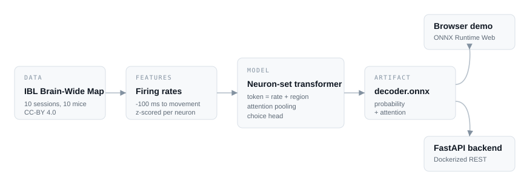

<p align="center">
  
</p>

<p align="center">
  <b>Decode a mouse's choice from neural population activity before it moves.</b><br>
  One shared model, runs in your browser, explains every prediction.
</p>

<p align="center">
  <a href="https://mustafa-elsherif.github.io/volition/">Live demo</a> ·
  <a href="#results">Results</a> ·
  <a href="#api">API</a> ·
  <a href="MODEL_CARD.md">Model card</a> ·
  <a href="DEPLOYMENT.md">Deployment</a>
</p>

---

Volition reads the firing rates of recorded neurons in the 0.1 second before a mouse
moves a wheel and predicts which way it chose. The decoder is a single
permutation-invariant set transformer: each neuron is a token made of its firing rate
and its brain region, so one set of weights reads sessions that have completely
different neurons. It runs client-side with ONNX Runtime Web, and every prediction
comes with the pooling attention over neurons and brain regions.

The project is built on the public [IBL Brain-Wide Map](https://www.internationalbrainlab.com/)
(CC-BY 4.0), ten sessions from ten mice.

<p align="center">
  
</p>

## What it does

- **Decodes choice** from pre-movement neural population activity, above chance with one shared model across ten animals.
- **Explains predictions** with per-neuron and per-region pooling attention.
- **Runs in the browser** on real sample trials, with no server and no data leaving the page.
- **Reports honestly**, including where the method is weaker than per-session baselines and where it fails to generalize.

## Results

All numbers are held-out, averaged over three seeds (mean ± std). "Shared model" is
one neuron-set transformer evaluated on trials it never trained on, pooled across the
ten sessions. The per-session references are retrained for a single animal.

| Decoder | ROC AUC | Balanced accuracy |
|---|---|---|
| **Shared neuron-set transformer** | **0.748 ± 0.026** | 0.685 ± 0.017 |
| Per-session logistic regression | 0.888 ± 0.009 | 0.821 ± 0.013 |
| Per-session random forest | 0.930 ± 0.005 | 0.859 ± 0.005 |
| Majority / base rate | 0.612 ± 0.022 | 0.580 ± 0.017 |

The shared model is well calibrated (expected calibration error 0.044 ± 0.01).

**Honest findings:**

- A single shared model is less accurate than a model retrained per animal. Reading a variable, shared neuron set across animals trades accuracy for one deployable, interpretable model.
- **Self-supervised pretraining did not help** on this dataset: with pretraining 0.748 AUC versus 0.759 without, a difference within seed variance.
- **Transfer to an unseen animal is near chance**: leave-one-session-out AUC is 0.496 ± 0.064 for the transformer and 0.541 ± 0.096 for a region-pooled linear baseline. Pre-movement choice signals here do not transfer across animals through shared regions.
- **Graceful degradation**: dropping neurons at decode time lowers AUC smoothly, from 0.78 with all neurons to 0.73 at half removed and 0.58 at 90% removed.

Reproduce every number:

```
python -m src.models.run_experiments
```

This writes the result tables to `results/model/` and the serialized artifact to `artifacts/`.

## Architecture

<p align="center">
  
</p>

- `src/data/` builds the ten processed sessions from IBL (firing rates in the pre-movement window).
- `src/models/` holds the baselines, the set transformer, training, and serialization.
- `src/evaluation/` holds metrics and resampling statistics.
- `api/` is the FastAPI service that serves the model.
- `web/` is the static dashboard with in-browser inference.

## Quickstart

```
git clone https://github.com/Mustafa-elsherif/volition.git
cd volition
py -3.12 -m venv .venv
.venv\Scripts\activate
python -m pip install --upgrade pip
pip install -r requirements.txt
```

On macOS or Linux use `python3.12 -m venv .venv` and `source .venv/bin/activate`.

Run the backend (loads `artifacts/` at startup):

```
cd api
uvicorn app.main:app --reload
```

Serve the dashboard locally:

```
cd web
python -m http.server 8099
# open http://localhost:8099
```

## API

The backend serves the same model. Send a trial as a list of neurons, each with a
z-scored pre-movement firing rate and a Beryl region acronym.

```bash
curl -X POST "http://localhost:8000/decode" \
  -H "content-type: application/json" \
  -d '{"neurons": [{"rate": 1.8, "region": "VISp"}, {"rate": -0.4, "region": "CP"}]}'
```

```json
{
  "probability": 0.73,
  "choice": "Right (choice = +1)",
  "confidence": 0.46,
  "region_contributions": [{"region": "VISp", "attention": 0.31, "n_neurons": 1}]
}
```

| Method | Path | Purpose |
|---|---|---|
| POST | `/decode` | Decode one trial with per-neuron and per-region attributions |
| GET | `/model-info` | Model metadata and held-out metrics |
| GET | `/samples` | Bundled sample trials |
| POST | `/assistant` | Grounded multilingual assistant |

Interactive API docs are at `/docs` when the server is running. See [api/README.md](api/README.md).

## Tests

```
python -m pytest            # core pipeline and models
cd api && python -m pytest  # API contract tests
```

## Data and licence

Data: International Brain Laboratory Brain-Wide Map, release `2023_12_bwm_release`,
CC-BY 4.0. See [docs/data_card.md](docs/data_card.md). Volition decodes an offline
research dataset, not a live brain-computer interface.

Code is released under the [MIT License](LICENSE).
