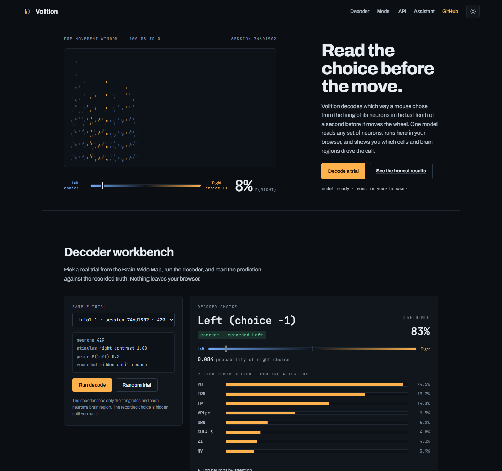

<p align="center">
  
</p>

<p align="center">
  <b>Decode a mouse's choice from neural population activity before it moves.</b><br>
  One shared model, runs in your browser, explains every prediction.
</p>

<p align="center">
  <a href="https://mustafa-elsherif.github.io/volition/"></a>
  <a href="https://doi.org/10.5281/zenodo.24616025"></a>
  
  
</p>

<p align="center">
  <a href="https://mustafa-elsherif.github.io/volition/">Live demo</a> ·
  <a href="#results">Results</a> ·
  <a href="#reproducibility">Reproducibility</a> ·
  <a href="#api">API</a> ·
  <a href="docs/MODEL_CARD.md">Model card</a> ·
  <a href="DEPLOYMENT.md">Deployment</a>
</p>

---

## Paper

> **A Region-Tagged Set Transformer for Shared Choice Decoding Across the Brain-Wide Map, and the Limits of Region-Level Transfer**
> Mustafa Nabil Abdelraheem (El Sewedy University of Technology, Cairo, Egypt)
> Published as a preprint on Zenodo: [10.5281/zenodo.24616025](https://doi.org/10.5281/zenodo.24616025)

```bibtex
@misc{abdelraheem2026volition,
  title     = {A Region-Tagged Set Transformer for Shared Choice Decoding
               Across the Brain-Wide Map, and the Limits of Region-Level Transfer},
  author    = {Abdelraheem, Mustafa Nabil},
  year      = {2026},
  publisher = {Zenodo},
  doi       = {10.5281/zenodo.24616025},
  url       = {https://doi.org/10.5281/zenodo.24616025}
}
```

A machine-readable citation

## Overview

Volition reads the firing rates of recorded neurons in the 0.1 second before a mouse
moves a wheel and predicts which way it chose. The decoder is a single
permutation-invariant set transformer: each neuron is a token made of its firing rate
and an embedding of its Beryl brain region, so one set of weights reads sessions that
have completely different neurons. It runs client-side with ONNX Runtime Web, and
every prediction comes with the pooling attention over neurons and brain regions.

The project is built on the public [IBL Brain-Wide Map](https://www.internationalbrainlab.com/)
(CC-BY 4.0), ten sessions from ten mice.

<p align="center">
  
</p>

## Results

All numbers are measured on held-out trials the model never trained on. ROC AUC and
balanced accuracy are reported with a bootstrap 95% confidence interval over the
held-out trials (seed 0). "Shared model" is one neuron-set transformer evaluated on
pooled held-out trials across the ten sessions. The per-session references are
retrained for a single animal.

| Decoder | ROC AUC [95% CI] | Balanced acc. [95% CI] | Protocol |
|---|---|---|---|
| **Shared neuron-set transformer** | 0.78 [0.75, 0.81] | 0.71 [0.68, 0.73] | pooled held-out |
| Per-session logistic regression | 0.90 [0.88, 0.92] | 0.83 [0.81, 0.86] | per-session 5-fold |
| Per-session random forest | 0.93 [0.92, 0.95] | 0.86 [0.84, 0.89] | per-session 5-fold |

Across three seeds (mean ± std): shared transformer ROC AUC 0.748 ± 0.026, balanced
accuracy 0.685 ± 0.017, expected calibration error 0.044 ± 0.010; per-session logistic
0.888 ± 0.009; per-session random forest 0.930 ± 0.005; majority baseline 0.612 ± 0.022.

**Honest findings:**

- A single shared model is less accurate than a model retrained per animal (paired Wilcoxon over the ten sessions, p < 0.002), and significantly above chance (p < 0.002). Reading a variable, shared neuron set across animals trades accuracy for one deployable, interpretable model.
- **Self-supervised pretraining did not help** on this dataset: with pretraining 0.748 AUC versus 0.759 without, a difference within seed variance.
- **Transfer to an unseen animal is near chance**: leave-one-session-out AUC is 0.496 ± 0.064 for the transformer and 0.541 ± 0.096 for a region-pooled linear baseline.
- **Graceful degradation**: dropping neurons at decode time lowers AUC smoothly, from 0.78 with all neurons to 0.73 at half removed and 0.58 at 90% removed.

Figures and the full evaluation are in [notebooks/05_decoding_results.ipynb](notebooks/05_decoding_results.ipynb) and `results/model/`.

## Reproducibility

The experiments run on CPU or a single GPU. The dataset is small, so a training fold
finishes in under a minute.

```bash
# 1. environment (Python 3.12)
python -m venv .venv && . .venv/Scripts/activate   # or source .venv/bin/activate
pip install -r requirements.txt

# 2. build the ten processed sessions from the public IBL database
python -m src.data.build_dataset

# 3. run every experiment (seeds 0, 1, 2) and train the shipped model
python -m src.models.run_experiments
```

Step 3 writes the result tables to `results/model/` and the serialized model to
`artifacts/`. Seeds are fixed: the experiment seeds are `0, 1, 2` and the shipped
model uses seed `42` (see `src/models/run_experiments.py` and `config.yaml`).

Expected held-out numbers (mean ± std over three seeds), which you should reproduce
within seed variance:

| Quantity | Expected |
|---|---|
| Shared model ROC AUC | 0.748 ± 0.026 |
| Shared model balanced accuracy | 0.685 ± 0.017 |
| Shared model ECE | 0.044 ± 0.010 |
| Per-session logistic AUC | 0.888 ± 0.009 |
| Per-session random forest AUC | 0.930 ± 0.005 |
| Leave-one-session-out AUC | 0.496 ± 0.064 |

Run the tests:

```bash
python -m pytest            # core pipeline and models
cd api && python -m pytest  # API contract tests
```

## Trained artifacts

The serialized model ships in [`artifacts/`](artifacts): `model.pt` (PyTorch),
`decoder.onnx` (ONNX, probability and attention outputs, used by the API and the
browser), `metadata.json` (region vocabulary and held-out metrics), and
`samples.json` (bundled sample trials). The same files are released with each tagged
version under [Releases](https://github.com/Mustafa-elsherif/volition/releases).

## Architecture

<p align="center">
  
</p>

```
volition/
├── src/
│   ├── common/      settings and data checks
│   ├── data/        build the processed sessions from IBL
│   ├── models/      set transformer, baselines, training, serialization, experiments
│   └── evaluation/  metrics and resampling statistics
├── api/             FastAPI service (Dockerized) that serves the model
├── web/             static dashboard with in-browser ONNX inference
├── notebooks/       data, preprocessing, modelling, and evaluation notebooks
├── artifacts/       serialized model and sample trials
├── results/model/   held-out result tables
└── docs/            model card, data card, architecture diagram
```

## Quickstart

```bash
git clone https://github.com/Mustafa-elsherif/volition.git
cd volition
python -m venv .venv && . .venv/Scripts/activate
pip install -r requirements.txt
```

Run the backend (loads `artifacts/` at startup):

```bash
cd api && uvicorn app.main:app --reload   # http://localhost:8000/docs
```

Serve the dashboard locally:

```bash
cd web && python -m http.server 8099      # http://localhost:8099
```

## API

Send a trial as a list of neurons, each with a z-scored pre-movement firing rate and
a Beryl region acronym.

```bash
curl -X POST "http://localhost:8000/decode" \
  -H "content-type: application/json" \
  -d '{"neurons": [{"rate": 1.8, "region": "VISp"}, {"rate": -0.4, "region": "CP"}]}'
```

```json
{
  "probability": 0.73,
  "choice": "Right (choice = +1)",
  "confidence": 0.46,
  "region_contributions": [{"region": "VISp", "attention": 0.31, "n_neurons": 1}]
}
```

| Method | Path | Purpose |
|---|---|---|
| POST | `/decode` | Decode one trial with per-neuron and per-region attributions |
| GET | `/model-info` | Model metadata and held-out metrics |
| GET | `/samples` | Bundled sample trials |
| POST | `/assistant` | Grounded multilingual assistant |

Full API notes are in [api/README.md](api/README.md), and interactive docs are at `/docs` when the server runs.

## Data and licence

Data: International Brain Laboratory Brain-Wide Map, release `2023_12_bwm_release`,
CC-BY 4.0. See [docs/data_card.md](docs/data_card.md). Volition decodes an offline
research dataset, not a live brain-computer interface.

Code is released under the [MIT License](LICENSE).
